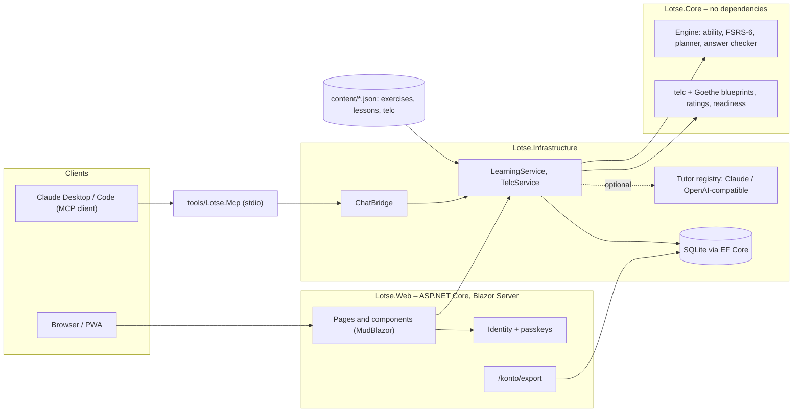
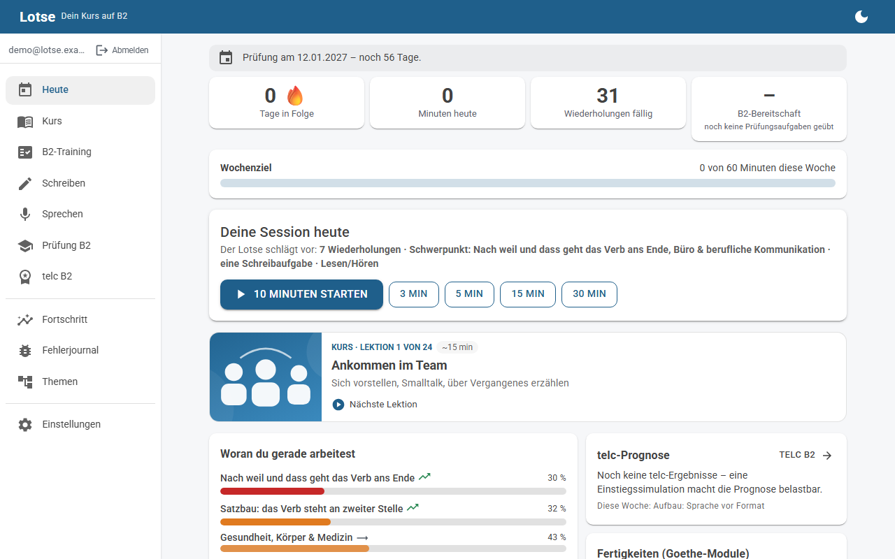
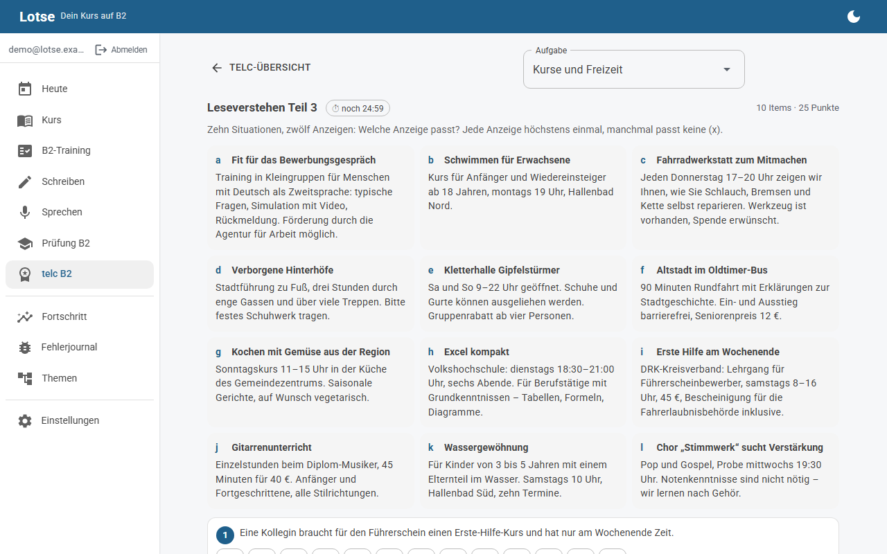
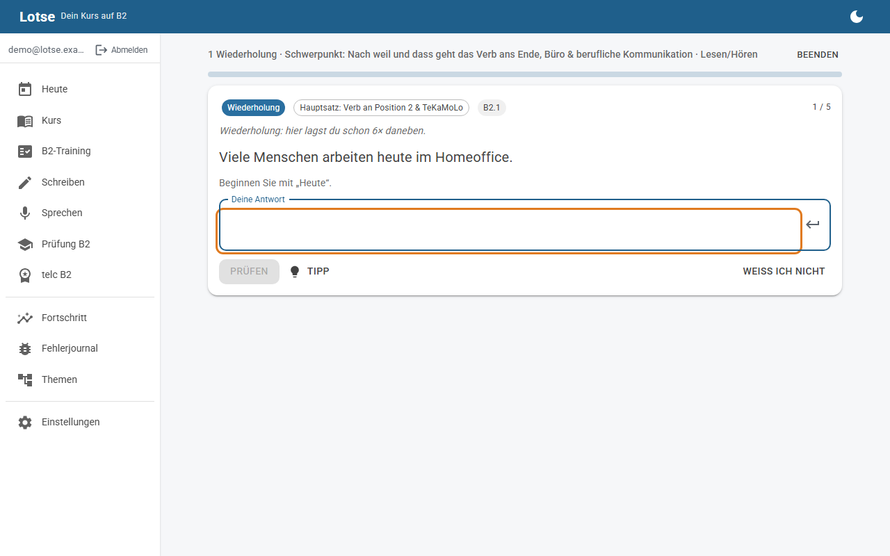
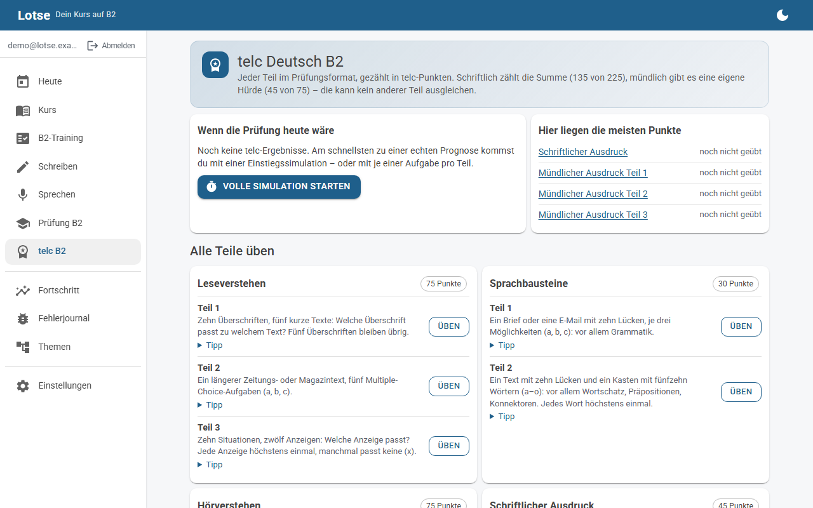
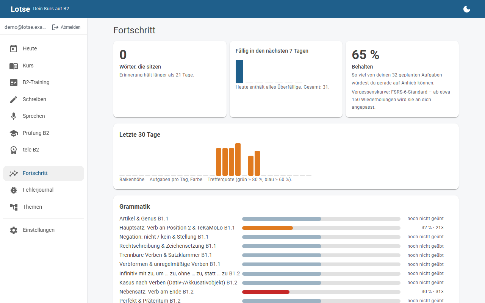
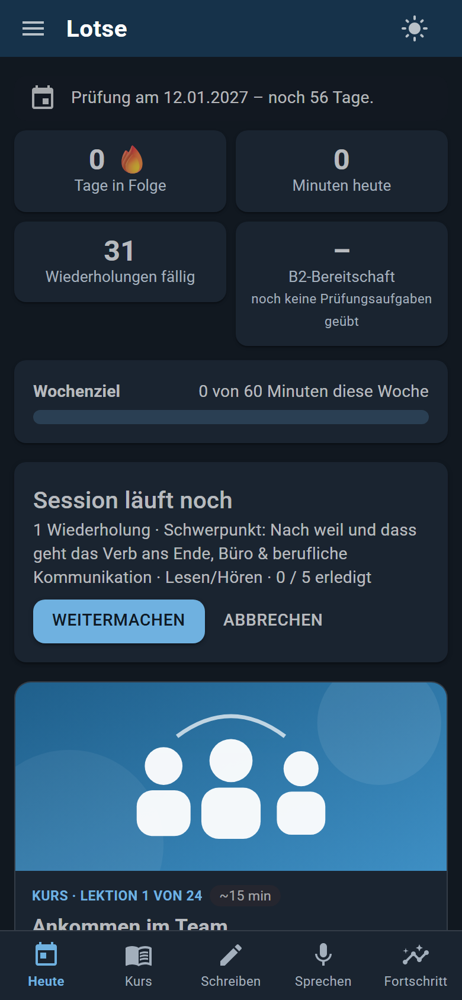

# Lotse – adaptive German coach for a real B2

[](https://github.com/aco993/Lotse/actions/workflows/ci.yml)


[](LICENSE)

**Lotse** (German for a harbour pilot) is a personal, adaptive German-learning application built to get one specific learner – a Serbian-speaking software developer living in Germany – from an uneven B1–B2 to a solid, exam-ready B2 (telc Deutsch B2 or Goethe-Zertifikat B2).

It is not a course. It is a closed loop: every answer updates a per-topic ability model, every mistake is tagged with an error code, and a planner composes each day's 5–30-minute session from due repetitions, targeted drills on the weakest topics, one production task (writing or speaking) and scheduled re-checks of topics that used to be weak.

> Concept and methodology: [docs/KONZEPT.md](docs/KONZEPT.md) · Roadmap: [docs/PLAN.md](docs/PLAN.md) · Architecture: [docs/ARCHITEKTUR.md](docs/ARCHITEKTUR.md)
> User guide (Serbian): [docs/UPUTSTVO.md](docs/UPUTSTVO.md) · Grammar coverage report: [docs/GRAMMATIK_ABDECKUNG.md](docs/GRAMMATIK_ABDECKUNG.md)
>
> Languages, deliberately: docs and code comments in English; the app's interface, changelog and commit messages in German (the language being learned); the user guide in Serbian, the learner's first language.

## At a glance

- **A closed loop, not a course.** Rasch/Elo ability per skill node, FSRS-6 spaced repetition fitted to the learner, a planner that explains every choice, and a 7/21/60-day re-check for recovered weaknesses. Deterministic and unit-tested.
- **Both B2 exams, in their own formats.** Every part of telc Deutsch B2 (Lesen 1–3, Sprachbausteine 1–2, Hören 1–3, the email, the three oral parts), counted in telc points, with full simulations and a plan counted back from the exam date. The Goethe-Zertifikat B2 blueprint sits next to it. All tasks are original texts in the exam format, never copied exam material; the official free mock exams are linked, and their paper results feed the same forecast.
- **Works without any key.** 2,250 exercises, a 24-lesson story course, rule-based feedback on free writing built for what a Serbian speaker gets wrong in German (gender, case, verb bracket, register), held to zero false alarms on 25,000 words of correct German in CI, local neural speech, and a read-aloud pronunciation check.
- **AI with guardrails, and measured.** An optional tutor (Groq, Claude, Ollama, any OpenAI-compatible server) gives hints as a ladder and never the answer, rates writing on telc criteria, and writes new telc tasks that pass format rules, a copy check, a critic model and a human review. The rater is evaluated against a golden set ([docs/EVALS.md](docs/EVALS.md)).
- **Your chat, connected.** An MCP server lets Claude Desktop or Claude Code read the learner's state and write checked exercises back ([docs/MCP.md](docs/MCP.md)).
- **Built like a product.** Accounts with passkeys, per-account isolation tested by enumerating the EF model, a data export, WCAG 2.2 AA checked by axe-core on phone and desktop in light and dark, a light/dark choice that follows the device or is remembered, a Docker image with a demo mode, a one-click Windows install that can put the app on your phone over Tailscale, and CI with a format gate, 496 tests and Playwright E2E.

The full list, with the reasoning behind each piece: [docs/FEATURES.md](docs/FEATURES.md).

## Architecture



Dependencies point inward: the engine knows nothing about EF Core, Blazor or any AI SDK, which keeps it testable in milliseconds. Details: [docs/ARCHITEKTUR.md](docs/ARCHITEKTUR.md).

## Screens

| Heute | telc Leseverstehen Teil 3 | Session |
|---|---|---|
|  |  |  |
| The exam date, due reviews, the weekly goal and one button for today's planned session; below it the weakest topics in plain language and the telc forecast. | Twelve ads, ten situations, one answer row each, and the exam's timer. Every task is an original text in the exam format. | One item per step with topic and level, immediate feedback, the Serbian contrast, and hints before answers. |

| telc overview | Fortschritt | Phone, dark |
|---|---|---|
|  |  |  |
| Points per part against the pass marks, where the points are lost, and this week's plan. | What has stuck, what falls due, and how sure each estimate is. | Bottom navigation, dark mode (device or own choice), installable as a PWA. |

Also: *Kurs* (24 story-driven lessons), *Schreiben* (micro tasks, exam Teil 1/2), *Sprechen* (spontaneous, Vortrag, discussion with AI partner), *Prüfung B2* (blueprint + simulations), *Fortschritt*, *Fehlerjournal*, *Themen* (focus sessions, generate exercises), *Einstellungen*, *Konto* (register/log in/change password - every other page requires being signed in).

## Quick start

Requirements: .NET 10 SDK **10.0.300 or newer** (`global.json` pins the 10.0.3xx feature band - `dotnet --list-sdks` must show one; a 10.0.1xx from an older installer will not do). Chrome or Edge for speech recognition (any browser for the rest).

```bash
git clone https://github.com/aco993/Lotse.git && cd Lotse
dotnet run --project src/Lotse.Web
```

Open http://localhost:5178 (or the port printed in the console), register an account (no email confirmation required - registration signs you in right away), and you're at the dashboard. Data lives in `src/Lotse.Web/data/lotse.db` (SQLite, created on first start).

No mail server is configured on a fresh clone, so "Passwort vergessen?" logs the reset link to the console instead of emailing it - watch the terminal Lotse is running in after requesting one.

### A public demo, free

[](https://render.com/deploy?repo=https://github.com/aco993/Lotse)

The button builds the Docker image on Render's free tier (no card) with demo mode on: visitors click "Demo ansehen" and land in an account with two weeks of history. It sleeps after 15 minutes without traffic. Details in [docs/DEPLOY.md](docs/DEPLOY.md).

### On Windows, without a terminal

```powershell
powershell -ExecutionPolicy Bypass -File tools/install-windows.ps1
```

This builds a self-contained copy into `%LOCALAPPDATA%\Lotse\app` and adds *Lotse* to the Start menu and the desktop. A click starts the server in the background if it is not already running, then opens the browser. Data lives in `%LOCALAPPDATA%\Lotse\data`, apart from the program; on the first install an existing database from `src/Lotse.Web/data` is copied over. `-Autostart` starts the server at sign-in, `-Uninstall` removes the program and keeps the data. Without the SDK: every tagged release carries a zip (`Lotse-<version>-win-x64.zip`); unzip it and double-click `Lotse starten.cmd`.

### Better pronunciation (optional, recommended)

Out of the box, listening tasks use the browser's own German voices. On Windows those are the older Hedda/Katja/Stefan
voices and they sound noticeably robotic. One command replaces them with a neural voice that runs locally:

```powershell
powershell -ExecutionPolicy Bypass -File tools/install-piper.ps1
```

Windows PowerShell 5.1 is enough - the script was written for it - so nothing needs installing first. (If you downloaded the repository as a ZIP rather than cloning it, run `Get-ChildItem -Recurse tools\*.ps1 | Unblock-File` once: Windows marks extracted files as web content and refuses to run them.) The step is Windows-only for now; on macOS and Linux the browser voices stay in use, or install Piper yourself and point `Lotse:Tts:PiperPath` at it.

It downloads Piper (MIT, ~21 MB) and two German voices (CC0, ~120 MB together) into `%LOCALAPPDATA%\Lotse`:
`de_DE-thorsten-medium` as the default and male voice, `de_DE-kerstin-low` for the women in the story - so Herr Krüger
and Sabine no longer sound like the same person. Nothing goes into the repo, no API key, and no sentence ever leaves
the machine; a line renders in about half a second and is then cached.

Lotse picks the voices up automatically and logs `Lokale Sprachausgabe aktiv: ...` at startup. Without the step the
browser voices simply stay in use, and with only the default voice installed every role speaks with it. Rendered audio
is cached under the data directory and served only to a signed-in learner. The script is idempotent - re-running it
skips what is already there, which is also how you add the second voice later.

### Optional: enable the AI tutor

Open **Einstellungen → KI-Tutor**, pick a provider, paste a key, press *Verbindung testen*, then *Speichern & aktivieren*. The key is stored encrypted on this machine only. Groq offers a free tier (https://console.groq.com/keys) and answers in seconds; Claude gives the best exam-grade feedback; Ollama runs fully offline.

**Running Ollama? Give the model a bigger context first.** Ollama's default of 4096 tokens is not enough for a whole evaluation: the same request that produced valid JSON in 117 seconds with `num_ctx 8192` ran for ten minutes and returned nothing at the default. The JSON schema is not the problem (122 s with it, 139 s without) - the context is. Create a derived model once; it is a config layer over the same weights and costs no extra disk:

```powershell
ollama pull qwen2.5:7b
"FROM qwen2.5:7b`nPARAMETER num_ctx 8192" | Out-File -Encoding ascii Modelfile
ollama create qwen2.5-lotse -f Modelfile
```

(On macOS/Linux: `printf 'FROM qwen2.5:7b\nPARAMETER num_ctx 8192\n' > Modelfile` for the second line.)

Then enter `qwen2.5-lotse` as the model and leave the time limit at the preset's 300 s.

Keys can also come from environment variables (`GROQ_API_KEY`, `ANTHROPIC_API_KEY`, `OPENROUTER_API_KEY`, `OPENAI_API_KEY`, …) or from configuration defaults in `appsettings.json` → `Lotse:Tutor` (`Preset`, `Model`, `BaseUrl`). See `appsettings.Ollama.json` and [docs/UPUTSTVO.md](docs/UPUTSTVO.md) §6 for a provider comparison. Without a tutor every feature except AI evaluation, generation and the discussion partner is available.

### Tests

```bash
dotnet test tests/Lotse.Core.Tests tests/Lotse.Web.Tests
```

No browser needed for these. (A bare `dotnet test` at the root also runs the Playwright suite below, which is red until Chromium has been downloaded once - do that step first if you want everything in one go.)

496 tests (369 engine/content/service/evals/MCP bridge/export, 127 component/host): lesson and dialogue integrity, grammar coverage and production pressure against the B2 reference inventory, engine (ability updates, answer checking, scheduler, re-check lifecycle, planner behaviour), content integrity (every exercise valid, every core node covered below and above the B1/B2 boundary, every seed answer accepted by the checker), application service against a temporary SQLite database, migrations vs. model drift, the OpenAI-compatible provider against a scripted HTTP handler (schema fallback, retries, error mapping), tutor settings persistence and encryption, multi-user isolation (two accounts, neither can see the other's skill state, sessions or Tutor API key; a reset empties every per-account table in the EF model for one account and none for the other), every shipped telc task rendered in its page, a paper mock-exam result stored as a simulation and kept out of the learner model, the official-material links (HTTPS, publishers' hosts only), answers after a hint never passing a re-check, the data export (every per-account table, nothing of another account, no API key), the exam rules (play counts per Hören part, time limits per Lesen part, speaker split of conversations), the hint ladder (no rung of any exercise contains its answer), the telc task pipeline with a scripted tutor (format, copy check, critic, review, restart), the eval harness (golden set valid, kappa against a hand-computed example, the rule baseline beating "always B"), the open-redirect guard and the German Identity messages, bUnit component tests for the exercise flow, and the real host in-process (`WebApplicationFactory`: public static assets, static login page, signed-out redirects, password policy). `dotnet format --verify-no-changes` is clean (EF migrations exempted as generated code).

### End-to-end (Playwright)

```powershell
dotnet build
powershell -ExecutionPolicy Bypass -File tests/Lotse.E2E/bin/Debug/net10.0/playwright.ps1 install chromium   # once (~150 MB)
dotnet test --project tests/Lotse.E2E
# or, without the download, on the Edge or Chrome already installed: set LOTSE_E2E_CHANNEL=msedge (or chrome) first
```

The real app on Kestrel (`WebApplicationFactory.UseKestrel`, .NET 10) in a real headless Chromium: the learner's day from registration to a resumed session, and the full passkey ceremony via the browser's virtual authenticator. On failure a Playwright trace lands in `tests/Lotse.E2E/bin/.../playwright-traces/` (`playwright show-trace <zip>`). CI runs all of it on every push to `main` and on every pull request.

## Stack

| Layer | What | Why |
|---|---|---|
| Runtime | .NET 10 (LTS), C# 14, `global.json`-pinned SDK, central package management, `TreatWarningsAsErrors`, `AnalysisLevel=latest`, `dotnet format` as a gate | One warning-free, formatter-clean build everywhere |
| UI | ASP.NET Core Blazor Web App: InteractiveServer for the app, static SSR for the Identity pages (decided per page from its layout, in `App.razor`); MudBlazor 9 | One process, one language, no API layer for a personal tool; static pages where a real HTTP response is needed |
| Accounts | ASP.NET Core Identity (cookies, lockout, passkeys/WebAuthn via Identity schema v3, German error messages), `ICurrentUserAccessor` seam | Everything per account, Core stays account-free |
| Data | EF Core 10 + SQLite, migrations (`DatabaseInitializer` baselines pre-migration files), Data Protection for the API key at rest | Zero-install persistence; keys never in clear text |
| AI | Anthropic SDK (Claude) and any OpenAI-compatible endpoint (Groq, Ollama, LM Studio, OpenRouter, Mistral, DeepSeek, OpenAI), structured JSON output with graceful fallback | Provider-agnostic, works offline with Ollama |
| Speech | Piper (MIT) rendering the voices `de_DE-thorsten` / `de_DE-kerstin` (CC0) locally, picked per character from the speaker label, WAVs cached and served behind the login; the browser's own voices as the fallback when Piper is not installed | Near-native German without a key, a cloud voice, or lesson text leaving the machine |
| Browser | Web Speech API (recognition, fallback voices), PWA manifest, CSS custom properties + `color-mix()` for theme-aware accents | Phone-first, installable, dark mode for free |
| Tests | xUnit v3 on Microsoft.Testing.Platform, bUnit 2, `WebApplicationFactory` in-process (TestServer) and on Kestrel, Playwright 1.64 with CDP virtual authenticator, axe-core for WCAG 2.2 AA | Engine in ms, components in memory, the host as it ships, the browser as the learner sees it |
| Delivery | GitHub Actions (format → build → tests → E2E, traces on failure; a tag builds and smoke-tests a self-contained Windows zip for the release), Dependabot (NuGet + actions, weekly, grouped), MIT | Green main, current dependencies, runs without the SDK |

## Project layout

```
content/                 taxonomy.json (nodes + error codes), exercises/*.json (the bank), lessons/*.json (the course)
src/Lotse.Core           domain model + learning engine, no dependencies
src/Lotse.Infrastructure EF Core (SQLite), content loader, Claude tutor, application service
src/Lotse.Web            Blazor Server UI (MudBlazor), browser speech interop
tests/Lotse.Core.Tests   xUnit v3 (Microsoft.Testing.Platform): engine, content, service, providers, migrations
tests/Lotse.Web.Tests    bUnit component tests + the host in-process (WebApplicationFactory)
tests/Lotse.E2E          Playwright: the real app on Kestrel in a real Chromium (daily loop, writing, passkeys, axe WCAG 2.2 AA)
tools/persona-harness    Playwright layer for persona tests and verify-fixes.mjs; validate-vocab.mjs for content packs
tools/Lotse.Mcp          MCP server (stdio): a chat assistant reads the learner's state and writes checked exercises and mistakes back
tools/Lotse.Evals        eval harness for the AI rating (docs/EVALS.md)
tools/install-piper.ps1  one-off setup of the local neural voice (Piper + de_DE-thorsten), idempotent
tools/install-windows.ps1 self-contained install with a Start-menu entry and launcher; tools/release/ holds the zip's starter
docs/                    concept, plan, architecture, grammar-coverage report
tools/                   B2 grammar reference inventory + the script that measures coverage
```

## How this was built

With an AI pair (Claude Code) — the commit trailers say so, and there is no reason to hide it. What kept that honest was the discipline around it: every change goes through the same gates a team would enforce — `dotnet format`, the 434 tests across engine, content, service, components, host and Playwright, and, for anything visible, the page exercised in a browser before the commit. Commit messages carry the measurement behind the decision (tokens per second, a contrast ratio, a key distribution), the alternative that was rejected, and what was checked. Ten scripted personas ([docs/NUTZERTEST_2026-09.md](docs/NUTZERTEST_2026-09.md)) reviewed the app as a nurse on a phone, a keyboard-only user and a DaF examiner would; their findings became the 0.8.0 backlog. A full review on 2026-09-08 — pedagogy, code, repository, AI reliability, fresh install — produced the 0.9.0 changes listed in [CHANGELOG.md](CHANGELOG.md).

## Status

**0.9.0 + unreleased.** Done: course, adaptive engine (FSRS-6, Rasch/Elo), B2-Training, telc B2 with simulation and plan, accounts and passkeys, AI tutor with provider presets, hint ladder, telc task pipeline, eval harness, MCP server, read-aloud pronunciation check, automated WCAG 2.2 AA checks, five original tasks for every objective telc part, data export, Windows install and release package, Docker image and demo mode, local neural speech, Playwright E2E and CI. Next: an AI row in the eval table, examiner-rated golden set and oral transcripts in the evals, multi-voice listening for every part.

## License

MIT
