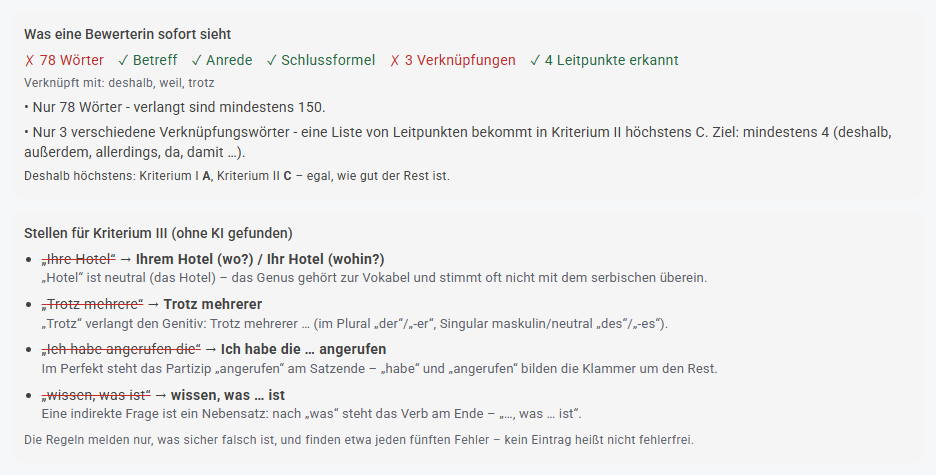

# Lotse – everything it does

The full feature list. The [README](../README.md) has the short version.

- **A course with a story.** 24 lessons in two parts follow two years at a Bremen software company. Part 1: the first day in the team, the first formal mail to the boss, a stand-up, an angry customer, the Bürgeramt, the flat and the neighbours, the doctor, a production incident, the home-office debate, weekend small talk, the salary talk, exam day. Part 2: mentoring a new colleague, a Kita parents' evening, organising the company outing, presenting to the customer, a team conflict, an evening course at the VHS, disputing the utility bill, rumours of a merger, an internal application, listening to the news, and the two exam days (Lesen, Schreiben). Each lesson opens with an interactive dialogue in which you choose your own lines and every option is explained, continues with a grammar focus explained through German↔Serbian (or German↔English) example pairs, each one speakable, and ends with a writing or speaking task.
- **Interactive exercise types.** Dialogues, spot-the-error (tap the wrong word in a colleague's message), pair matching, gap fill, transformation, translation, word order, vocabulary with article, dictation, free writing, speaking.
- **Skill map underneath.** 62 skill nodes (grammar, vocabulary, Redemittel, reading, listening, writing, speaking) on CEFR sub-bands, three of them above B2; 57 error codes; contrastive Serbian↔German notes on every interference-prone topic.
- **Adaptive engine, fully deterministic and unit-tested.** Rasch/Elo-style ability per node, SM-2-family spaced repetition with behaviour-derived grades, weak-area analysis with trends, a session planner that explains every choice, a 7/21/60-day re-check cycle for recovered weaknesses, exam readiness per module.
- **Production first.** Typed gap fills, transformations, Serbian→German translation, word order, vocabulary with article, dictation, daily free writing/speaking. Tolerant checking (umlauts, ß, one typo, capitalisation, missing article) that still logs every slip.
- **Works without any API key.** 2,251 exercises (1,041 vocabulary items with article, plural, example and a gloss in your bridge language), rule-based feedback on free writing, self-check rubrics with model answers, local neural speech.
- **Two bridge languages, one target language.** The interface, the tasks and the feedback are German throughout - that is the point. Serbian or English only carries the vocabulary prompts, the translation sources, the second column of the grammar tables and the contrastive notes, switchable per account. The notes are written for each first language rather than translated: what trips up a Serbian speaker (articles, verb-second) and an English one (cases, verb-final clauses) is not the same list.
- **B2 or C1 as the declared goal.** One setting moves one thing: how far above B2 the planner's focus may reach. A C1 learner gets the three C1 nodes - elevated vocabulary, the connectors that mark a C1 text (zumal, sofern, ungeachtet, geschweige denn) and the fixed phrases you cannot build word by word - plus the B2.2 grammar in their daily focus, and a "C1-Nähe" figure on Heute; a B2 learner never does. The placement, the difficulty targeting and the exam pages stay B2 - and the exam page says so, because an app without a C1 blueprint should not imply it has one.
- **Your field, as a nudge and nothing more.** Pick a Branche (IT, care, construction, medicine, office, retail, electrical engineering) and matching vocabulary nodes get a small priority boost while equally suitable exercises break ties in its favour - and the session says so when it mattered ("Vorgezogen, weil du in der Pflege arbeitest"). Weaknesses still decide what is practised; the field never hides material.
- **The course knows your name.** Lesson dialogues and model answers carry `{Vorname}` / `{Nachname}` / `{Name}` tokens instead of the author's name; the profile fills them in at the moment content is handed to one learner, so the shared exercise bank stays neutral and no name leaks between accounts on the same machine.
- **Progress you can act on, not points.** A weekly goal in minutes, a Monday review of the week that ended, and three cards built from the spaced-repetition state: how many items have stuck (stability past three weeks), how much falls due over the next seven days, and what share of the scheduled material you would get right this minute. No XP, no badges, no leaderboard.
- **Readiness with a direction.** The exam-readiness number keeps a daily snapshot and shows its change against roughly a week ago - or says nothing at all until there is something to compare with.
- **Measured grammar coverage.** A 51-item reference inventory of B2 grammar (`tools/b2-grammar-reference.json`, compiled from Profile Deutsch, the common ground of the standard B2 textbooks, and the Goethe rating criteria) is scored against the content by `tools/grammar-coverage.py`; every *Muss* item now reaches the top grade, every writing and speaking task demands a named structure in its rubric, and tests keep both from falling back. Report: [docs/GRAMMATIK_ABDECKUNG.md](GRAMMATIK_ABDECKUNG.md).
- **FSRS-6 spaced repetition, fitted to you.** The scheduler generation Anki ships: every item has a memory stability and a difficulty, comes due when its recall probability drops to 90 %, and a lapse shrinks stability instead of resetting it. After about 150 reviews the forgetting curve's decay is fitted to the learner's own history (one-parameter grid search on log loss - fitting all 21 weights would overfit one person's data). Grades come from behaviour (wrong / slip / hint / speed), never from self-rating.
- **Real feedback on free writing without any key.** A rule-based analyzer built for what a Serbian speaker's German actually trips over - haben/sein in the perfect, verb position after *weil/dass* and fronted adverbials, the missing comma, ä/ö/ü/ß, case after prepositions (gender from the vocabulary bank), n-declension, verb + preposition, gender and article agreement (gender from the vocabulary bank, 150 everyday nouns, compound heads and reliable suffixes), the accusative object, dative plural and genitive prepositions, the verb bracket after modals and in the perfect, indirect questions, da-compounds, formal register - tags every finding with a catalogue code so it feeds the journal and the learner model. Precision over recall, and measured: CI runs the rules over every piece of correct German in the bank (about 25,000 words) and fails on a single false alarm. On golden letters written after the rules they catch about one planted mistake in five; the AI tutor is there for the rest.

  
- **Tested by ten simulated learners.** A nurse on her phone, a keyboard-only user, a DaF examiner, a 19-year-old on TikTok time - each a scripted Playwright persona with its own account and a brief to be honest. Their report (`docs/NUTZERTEST_2026-09.md`) became the 0.8.0 backlog; `tools/persona-harness` re-checks every finding against the running app.
- **Separate accounts, own login, passkeys.** Register/log in (ASP.NET Core Identity, cookie auth, lockout, encrypted-at-rest API key) and everything - skill state, sessions, error journal, Tutor settings - is scoped to that account alone; a second account starts from a blank slate and can never see the first one's data or spend its API key. Every page requires sign-in by default (fallback authorization policy), with the login/registration pages the one deliberate exception. Passkeys (WebAuthn - fingerprint, face, device PIN) work alongside the password, end-to-end tested with Chromium's virtual authenticator.
- **AI with guardrails, and measured.** Hints come as a ladder (topic → rule → shape of the answer) and the AI may add a Socratic question, but no rung ever contains the answer: a test checks the whole bank, and an AI hint that gives it away is discarded. Unrestricted AI help during practice lowers later exam scores, and a hint-only tutor removes most of that harm (Bastani et al., PNAS 2025), which is why the app works this way. The AI rater is evaluated against a golden set: quadratic weighted kappa, ±1-band agreement, planted-error recall, quote precision and prompt-injection resistance. The rule-based rater and "always B" serve as baselines. Method, numbers and their limits are in [docs/EVALS.md](EVALS.md). The tutor also writes new telc tasks, which pass format rules, a copy check, a critic model and a human review before anyone practises them. The review page reports the pipeline's acceptance rate and how often the critic agrees with the human.
- **Your chat, connected (MCP).** `tools/Lotse.Mcp` lets Claude Desktop, Claude Code or any MCP client read your learning state (exam date, weakest topics, error journal, telc points) and write back checked exercises and the mistakes it found. The checks are the same ones the app's own tutor faces, and the chat cannot change scores. The chat becomes a client of the app instead of a replacement ([docs/MCP.md](MCP.md)).
- **Pronunciation, free.** Read spoken exam phrases aloud; the browser's recogniser transcribes, and each word shows whether it was understood, heard as something else, or missed. Honest about what it measures: intelligibility, not phonetics.
- **The official mock exams, linked and counted.** One page gathers what telc, the Goethe-Institut and Deutsche Welle publish for free: the telc B2 model test with its audio, the handbook, the rated writing samples, the B1 test as a warm-up, daily slow news for Hören Teil 1. Every address checked on the publisher's site, nothing copied. A result from the paper test goes in as right answers per part and is stored as a completed simulation, so real exam material calibrates the forecast - but never the per-topic ability, which a paper score cannot attribute.
- **Help is not evidence.** A right answer after a hint moves a topic's ability by at most an even chance at the item's difficulty, counts as neither success nor error and can never pass a re-check. Wrong after a hint is simply wrong.
- **telc Deutsch B2 as well as Goethe.** Every part in telc format and telc points, with own texts and no copied exam material. Includes a full simulation, a forecast of where the points are lost, and a weekly plan counted back from the exam date.
- **On the phone, on a server.** A three-minute quick session on Heute and as a shortcut on the app icon. A Docker image (data in a volume, non-root) runs behind a TLS proxy. Settings close registration on a personal server or offer a one-click demo account with two weeks of history on a public one. See [docs/DEPLOY.md](DEPLOY.md).
- **AI tutor (optional), provider-agnostic, configured in the app.** Rubric-based evaluation of writing and speaking with tagged errors that feed the model, on-demand exercise and reading/listening generation, a discussion partner for the oral exam. Pick a provider on the settings page: Groq (free, fast, the default suggestion), Claude via the official Anthropic SDK, OpenRouter, Ollama or LM Studio locally, Mistral, DeepSeek, OpenAI or any OpenAI-compatible server. Connection test, encrypted key storage (ASP.NET Data Protection), switch at runtime, graceful fallback from `json_schema` to `json_object` to plain text, retries with backoff. The time budget per answer follows the provider: hosted models get 120 s, local ones 300 s, because a 7B on a desktop GPU needs one to three minutes for a full evaluation - measured, not guessed.
- **Self-diagnosis and self-repair.** Health panel (content, database integrity, tutor) with one-click repair, `/health` endpoint, error boundary with friendly recovery, provider errors translated into actionable sentences.
- **Mobile-first details.** Bottom navigation on phones, installable PWA, system dark mode, keyboard shortcuts on desktop (Enter, digits) hidden on touch.
- **Exam realism.** Goethe B2 blueprint as data, writing/speaking tasks in exact exam formats, reading and audio-only listening tasks in exam part formats, readiness report against the 60 % rule.
- **Your data, as a file.** Einstellungen → *Deine Daten* downloads the whole learning record as one JSON file: profile, per-topic state, review schedule, sessions, answers, texts, error journal, telc results. The tables come from the EF model, not a hand-written list, so a table added later is exported without anyone remembering to; password, passkeys and the tutor key are left out (`DataExport`, tested against a second account).
- **One click on Windows.** `tools/install-windows.ps1` builds a self-contained copy, adds a Start-menu entry whose launcher starts the server in the background and opens the browser, keeps data apart from the program and carries an existing database over. Each tagged release attaches a zip that runs without the .NET SDK; CI starts it on a clean machine before publishing it.
